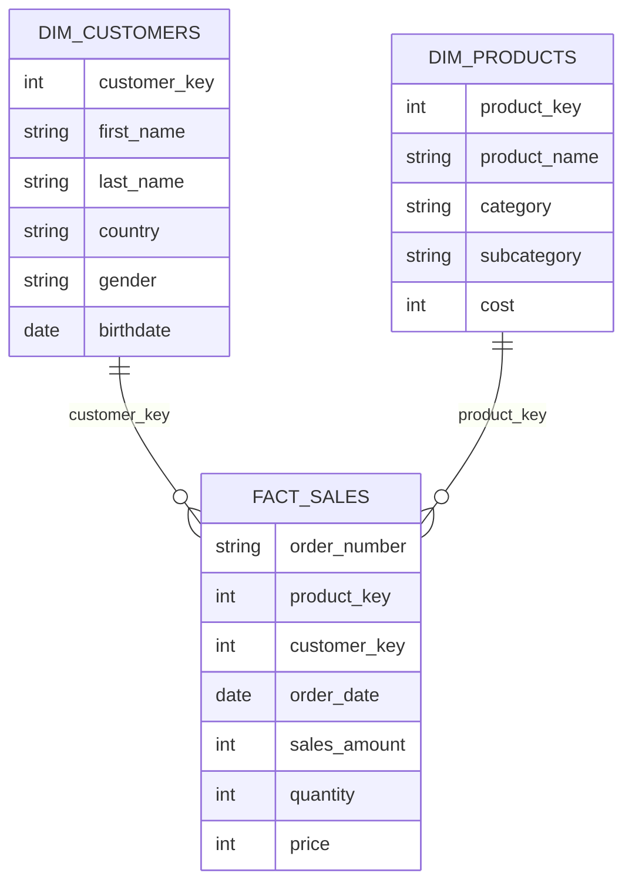
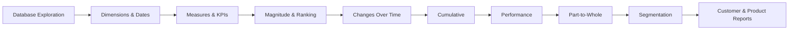

# SQL_Advanced_Data_Analysis_Project-
An end-to-end MySQL analytics project on a sales data warehouse (gold schema). It starts with Exploratory Data Analysis (EDA) and moves into advanced analytics: trend analysis, cumulative metrics, performance benchmarking, part-to-whole analysis, segmentation, and reusable customer and product reporting views.

# 📊 SQL Advanced Data Analytics


An end-to-end **MySQL analytics project** on a sales data warehouse (`gold` schema). It starts with Exploratory Data Analysis (EDA) and moves into advanced analytics: trend analysis, cumulative metrics, performance benchmarking, part-to-whole analysis, segmentation, and reusable **customer** and **product** reporting views.


---

## 📌 Project Highlights

- Analyzed **monthly, yearly and cumulative sales trends**, identifying **$16.34M in revenue in 2013**, a **179.77% growth over 2012**.
- Evaluated **performance** and conducted **part-to-whole analysis**, identifying **bikes as the main revenue contributor at 96.46% of total revenue ($28.32M)**.
- Created **customer and product SQL reports** using **CTEs and Window Functions** to show how **VIP, regular and new customers** perform by examining how products are performing.

---

## 🗂️ Dataset

| Table | Type | Rows | Description |
|---|---|---|---|
| `gold.fact_sales` | Fact | 60,398 | Order lines: order number, dates, sales amount, quantity, price |
| `gold.dim_customers` | Dimension | 18,484 | Customer details: name, country, gender, birthdate |
| `gold.dim_products` | Dimension | 295 | Product details: category, subcategory, cost |

**Data validation:** 0 duplicate customer keys, 0 duplicate product keys, 0 unmatched foreign keys in `fact_sales`, so joins don't drop rows. 19 sales rows with a NULL `order_date` are excluded from time-based analysis.



---

## 🛠️ Tech Stack & SQL Concepts

- **Database:** MySQL 8.0
- **Concepts:** CTEs, Window Functions (`SUM() OVER`, `AVG() OVER`, `LAG`, `ROW_NUMBER`), `CASE WHEN` segmentation, Views, Joins, Aggregations, Date functions, `UNION ALL`
- **Techniques:** EDA, time-series analysis, running totals, moving averages, YoY analysis, part-to-whole, customer and product segmentation



---

# Part 1: Exploratory Data Analysis (EDA)

**What I did:** explored tables and columns via `INFORMATION_SCHEMA`, checked countries and the product hierarchy, found the order date range (2010-12-29 to 2014-01-28), and built a consolidated KPI report with `UNION ALL`.

| KPI | Value |
|---|---|
| Total Sales | 29,356,250 |
| Total Quantity | 60,423 |
| Average Price | ~486.04 |
| Unique Orders | 27,659 |
| Total Products | 295 |
| Total Customers | 18,484 |

### 🏆 Ranking Analysis
Top and bottom products by revenue (`ORDER BY` + `LIMIT`, `ROW_NUMBER()`):


---

# Part 2: Advanced Analytics

### 📈 Changes Over Time
Monthly and yearly sales, customers and quantity. **2013 revenue reached $16.34M, up 179.77% from 2012.**

```sql
WITH yearly_sales AS (
    SELECT YEAR(order_date) AS order_year, SUM(sales_amount) AS total_sales
    FROM gold.fact_sales
    WHERE order_date IS NOT NULL
    GROUP BY YEAR(order_date)
)
SELECT order_year, total_sales,
       LAG(total_sales) OVER (ORDER BY order_year) AS previous_year_sales,
       ROUND((total_sales - LAG(total_sales) OVER (ORDER BY order_year)) * 100.0
             / NULLIF(LAG(total_sales) OVER (ORDER BY order_year), 0), 2) AS yoy_growth_pct
FROM yearly_sales
ORDER BY order_year;
```


### ➕ Cumulative Analysis
Running total of sales that restarts every year, using a window function:

```sql
SUM(total_sales) OVER (PARTITION BY YEAR(order_month) ORDER BY order_month) AS running_total_sales
```


### ⚖️ Performance Analysis
Each product's yearly sales compared with **its own average** (`AVG() OVER`) and the **previous year** (`LAG()`), flagged as *Above/Below Avg* and *Increase/Decrease*.


### 🥧 Part-to-Whole Analysis
**Bikes generate 96.46% of total revenue ($28.32M)**, far ahead of Accessories (2.39%) and Clothing (1.16%).


### 🧩 Data Segmentation

| Customer Segment | Rule | Customers | Sales |
|---|---|---|---|
| 🥇 VIP | Lifespan ≥ 12 months and spending > 5,000 | 1,653 | $10.76M |
| 🥈 Regular | Lifespan ≥ 12 months and spending ≤ 5,000 | 2,200 | $7.50M |
| 🆕 New | Lifespan < 12 months | 14,629 | $11.09M |


Products are segmented by total sales: **High-Performer** (> 50,000), **Mid-Range** (10,000 to 50,000) and **Low-Performer** (< 10,000). The 66 high performers generate $27.64M of the $29.35M in dated sales.


---

# Part 3: Final Reports (Reusable SQL Views)

### 👥 `gold.report_customers`
Name, age and age group, customer segment, recency, lifespan, orders, sales, quantity, products, **Average Order Value** and **Average Monthly Spend**.


### 📦 `gold.report_products`
Category, subcategory, cost, product segment, recency, lifespan, orders, sales, quantity, customers, **Average Selling Price**, **Average Order Revenue** and **Average Monthly Revenue**.


---

## 📁 Repository Structure

```
SQL-Advanced-Data-Analytics/
├── SQL_Advanced_Data_Analytics.sql   # EDA + advanced analytics + reports
├── dataset/
│   ├── gold_dim_customers.csv
│   ├── gold_dim_products.csv
│   └── gold_fact_sales.csv
├── images/                           # Charts used in this README
└── README.md
```

## ▶️ How to Run

1. Install **MySQL 8.0+** (CTEs and window functions need 8.0).
2. Open `SQL_Advanced_Data_Analytics.sql`, set the CSV paths in the setup block (or use Workbench's Table Data Import Wizard) and load the three tables into the `gold` schema.
3. Run the script section by section.
4. Query the final views:
   ```sql
   SELECT * FROM gold.report_customers;
   SELECT * FROM gold.report_products;
   ```

## 💡 What I Learned

- Writing readable, modular SQL with **CTEs**
- Using **window functions** for running totals, moving averages and YoY comparisons
- Turning raw data into **business insights** through segmentation and KPIs
- Validating data quality (duplicate keys, orphan keys, NULL dates) before analysis
- Packaging analysis into **reusable views** for reporting

## 📬 Contact

Shruti Kumbhare · [LinkedIn](https://www.linkedin.com/in/shrutikumbhare12/)
