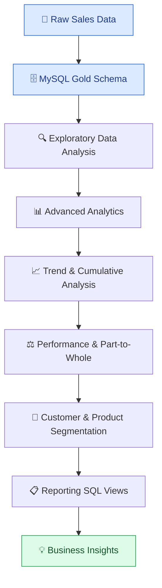
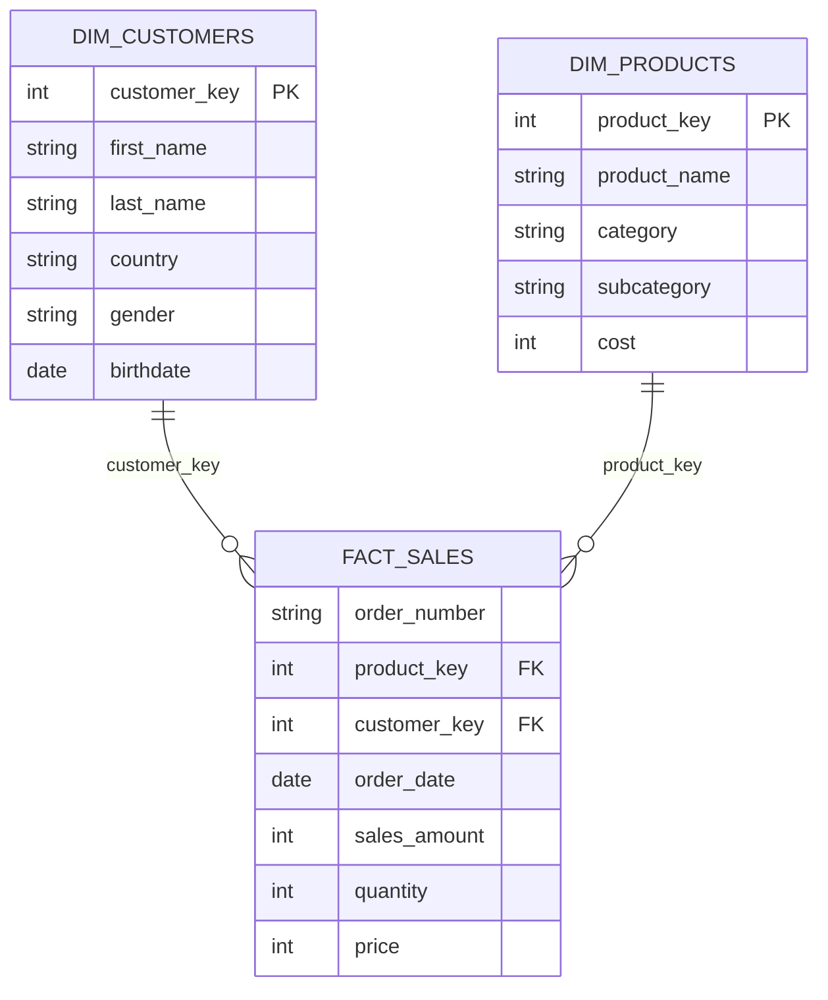

# 📊 Advanced SQL Data Analytics Project
### Turning Raw Sales Data into Meaningful Business Insights

<p align="center">
  
  
  
  
</p>

<p align="center">
  <b>An end-to-end SQL analytics project focused on exploring sales data, identifying business trends, measuring performance, and generating actionable insights using MySQL.</b>
</p>

---

## 🚀 Project Overview

This project demonstrates an end-to-end SQL analytics workflow using a sales data warehouse (`gold` schema).

The objective is to transform raw sales data into meaningful business insights through Exploratory Data Analysis (EDA), Advanced Analytics, Customer Segmentation, Product Performance Analysis, and reusable SQL reporting views.

The project covers real-world analytical techniques commonly used by Data Analysts and Business Intelligence professionals.

## 📌 Key Business Insights

<table>
<tr>
<td align="center" width="33%">
<h2>💰 $29.35M</h2>
<b>Total Sales</b>
</td>
<td align="center" width="33%">
<h2>👥 18,484</h2>
<b>Total Customers</b>
</td>
<td align="center" width="33%">
<h2>📦 60,423</h2>
<b>Total Quantity</b>
</td>
</tr>
<tr>
<td align="center">
<h2>🛒 27,659</h2>
<b>Unique Orders</b>
</td>
<td align="center">
<h2>📈 179.77%</h2>
<b>2013 YoY Growth</b>
</td>
<td align="center">
<h2>🚴 96.46%</h2>
<b>Bike Revenue Share</b>
</td>
</tr>
</table>

### 🔍 Highlights

- Generated approximately **$29.36 million** in total sales.
- Identified a **179.77% year-over-year sales growth** in 2013 compared to 2012.
- Discovered that Bikes contributed **96.46% of total revenue**.
- Segmented customers into VIP, Regular, and New categories.
- Identified high-performing products contributing the majority of sales.
- Developed reusable customer and product reporting views.

---

## 🏗️ Project Architecture

The project follows a structured analytical workflow:



## 🗂️ Dataset Overview

The project uses three tables from the Gold layer of a sales data warehouse.

| Table | Records | Description |
|---|---:|---|
| `gold.fact_sales` | 60,398 | Sales transactions |
| `gold.dim_customers` | 18,484 | Customer information |
| `gold.dim_products` | 295 | Product information |

### Database Relationship



**Data Quality Checks:**
- No duplicate customer keys.
- No duplicate product keys.
- No unmatched foreign keys in the sales table.
- 19 records with NULL order dates excluded from time-based analysis.

---

## 🔎 Part 1: Exploratory Data Analysis (EDA)

The first phase focused on understanding the database structure and identifying important business metrics.

**Key Activities:**
- Database and table exploration using `INFORMATION_SCHEMA`.
- Examining customer countries and product hierarchies.
- Identifying the sales date range.
- Calculating essential business KPIs.
- Combining KPI results using `UNION ALL`.

### Business KPIs

| KPI | Result |
|---|---:|
| Total Sales | 29,356,250 |
| Total Quantity | 60,423 |
| Average Selling Price | 486.04 |
| Unique Orders | 27,659 |
| Total Products | 295 |
| Total Customers | 18,484 |

---

## 📈 Part 2: Advanced SQL Analytics

This section focuses on extracting deeper insights using advanced SQL techniques.

### 1. Changes Over Time Analysis

Analyzed monthly and yearly trends in:
- Total Sales
- Customer Growth
- Quantity Sold
- Year-over-Year Revenue Growth

**Key Finding:** Sales revenue reached $16.34M in 2013, representing 179.77% growth compared to 2012.

SQL techniques:
`YEAR()`, `MONTH()`, `GROUP BY`, `LAG()`

### 2. Cumulative Analysis

Calculated running totals of sales to understand revenue progression over time.

**Techniques Used:**
- Window Functions
- `SUM() OVER()`
- `PARTITION BY`
- `ORDER BY`

### 3. Performance Analysis

Evaluated product performance by comparing yearly sales against:
- Individual product average sales.
- Previous year's sales performance.

**Key Techniques:**
- `AVG() OVER()`
- `LAG()`
- CASE WHEN statements

### 4. Part-to-Whole Analysis

Identified the revenue contribution of each product category.

| Category | Revenue Contribution |
|---|---:|
| Bikes | 96.46% |
| Accessories | 2.39% |
| Clothing | 1.16% |

**Key Finding:** Bikes are the dominant revenue-generating category.

### 5. Customer Segmentation

Customers were classified based on their spending behavior and customer lifespan.

| Segment | Customers | Sales |
|---|---:|---:|
| 🥇 VIP | 1,653 | $10.76M |
| 🥈 Regular | 2,200 | $7.50M |
| 🆕 New | 14,629 | $11.09M |

**Segmentation Rules:**
- VIP: Lifespan ≥ 12 months and spending > 5,000.
- Regular: Lifespan ≥ 12 months and spending ≤ 5,000.
- New: Lifespan < 12 months.

### 6. Product Segmentation

Products were classified based on total sales performance.

| Segment | Criteria |
|---|---|
| High Performer | Sales > 50,000 |
| Mid-Range | Sales between 10,000 and 50,000 |
| Low Performer | Sales < 10,000 |

**Key Finding:** 66 high-performing products generated $27.64M in sales.

---

## 📋 Part 3: Business Reporting Views

Created reusable SQL views to simplify customer and product-level reporting.

### 👥 Customer Report — `gold.report_customers`

Includes:
- Customer Name and Age
- Age Group
- Customer Segment
- Recency and Lifespan
- Total Orders and Sales
- Total Quantity and Products
- Average Order Value (AOV)
- Average Monthly Spend

### 📦 Product Report — `gold.report_products`

Includes:
- Product Category and Subcategory
- Product Cost and Segment
- Recency and Lifespan
- Total Orders and Sales
- Total Quantity and Customers
- Average Selling Price
- Average Order Revenue
- Average Monthly Revenue

These views make the analysis reusable and support further business reporting.

---

## 🛠️ Tech Stack & SQL Skills

<p>

</p>

| Category | Technologies & Concepts |
|---|---|
| Database | MySQL 8.0 |
| Querying | SQL |
| Data Exploration | INFORMATION_SCHEMA |
| Joins | INNER JOIN, LEFT JOIN |
| Aggregations | SUM, AVG, COUNT |
| Advanced SQL | CTEs, Subqueries |
| Window Functions | LAG, ROW_NUMBER, SUM OVER, AVG OVER |
| Conditional Logic | CASE WHEN |
| Analysis | Trend, Cumulative, Performance |
| Reporting | SQL Views, UNION ALL |

---

## 📁 Repository Structure

```text
SQL_Advanced_Data_Analysis_Project-/
│
├── SQL_Advanced_Data_Analytics.sql
│
├── gold.dim_customers.csv
├── gold.dim_products.csv
├── gold.fact_sales.csv
│
├── LICENSE
└── README.md
```

---

## ▶️ How to Run This Project

**Prerequisites:**
- MySQL 8.0 or higher
- MySQL Workbench (recommended)

**Steps:**

1. Clone this repository:

```bash
git clone https://github.com/analytical-shruti/SQL_Advanced_Data_Analysis_Project-.git
```

2. Open the project in MySQL Workbench.

3. Create the `gold` database/schema.

4. Import the three CSV files into their respective tables:
   - `gold.fact_sales`
   - `gold.dim_customers`
   - `gold.dim_products`

5. Update the CSV file paths in the SQL setup section if required.

6. Execute `SQL_Advanced_Data_Analytics.sql` section by section.

7. Access the final reporting views:

```sql
SELECT * FROM gold.report_customers;

SELECT * FROM gold.report_products;
```

---

## 🎯 Key Learnings

Through this project, I strengthened my ability to:

- Perform end-to-end data exploration using SQL.
- Write complex queries using CTEs and subqueries.
- Apply advanced window functions for analytical calculations.
- Analyze trends and year-over-year business growth.
- Evaluate customer and product performance.
- Perform data quality and validation checks.
- Convert raw data into meaningful business insights.
- Build reusable SQL views for business reporting.

---

## 👩‍💻 About the Author

**Shruti Kumbhare**

 Data Analyst | SQL | MySQL | Data Analytics | Business Intelligence

This project reflects my hands-on experience in using SQL to solve analytical problems and translate business data into actionable insights.

---

<p align="center">
  ⭐ If you find this project useful, consider giving it a star!
</p>

<p align="center">
  <b>Thank you for visiting my project!</b>
</p>
